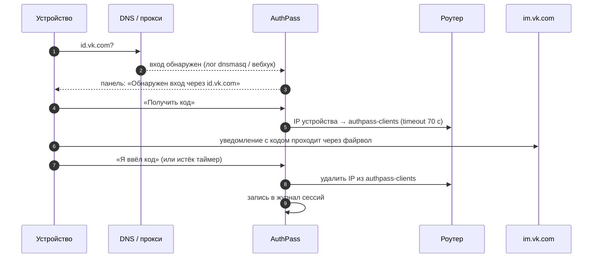
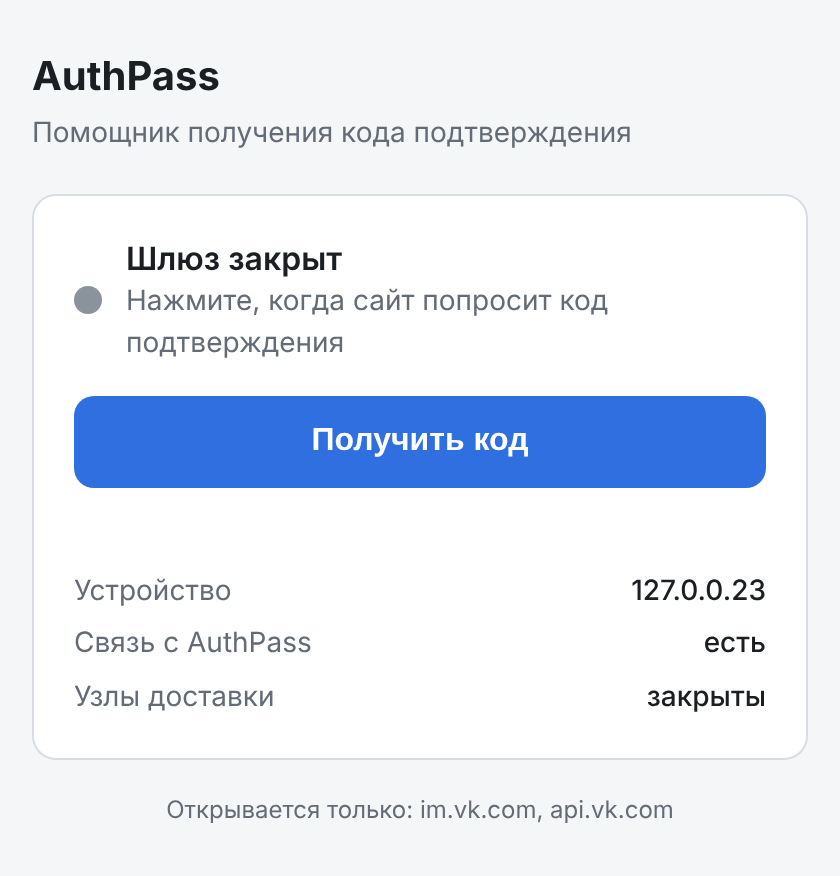
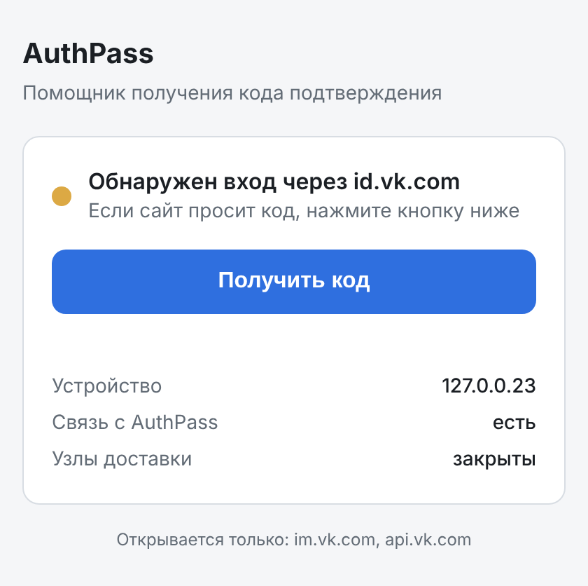
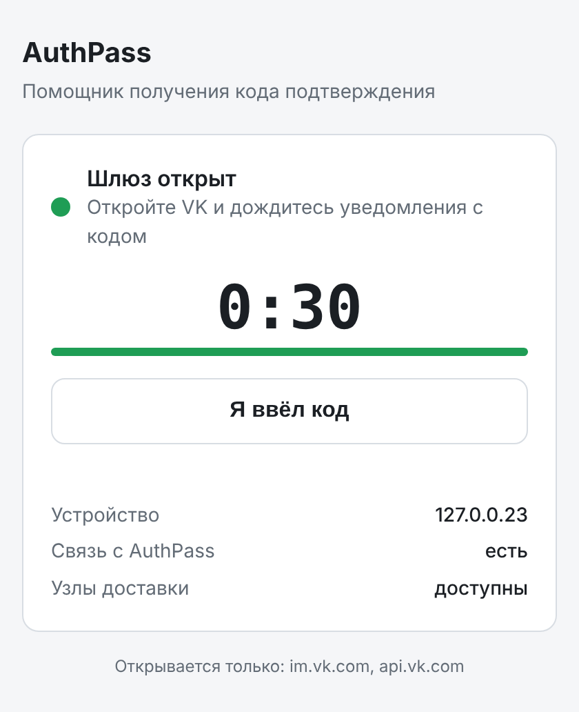
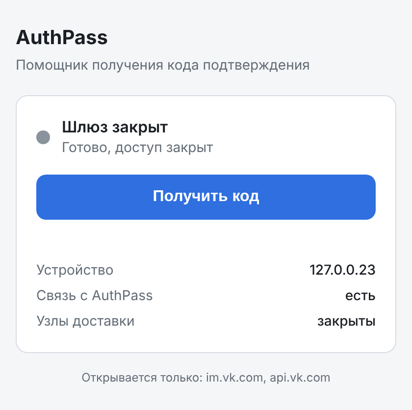
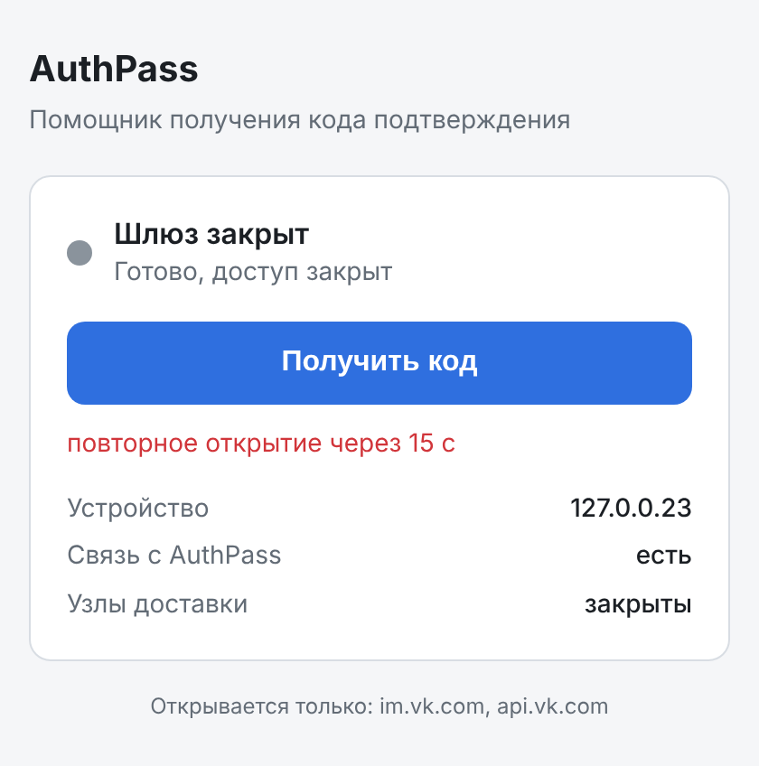
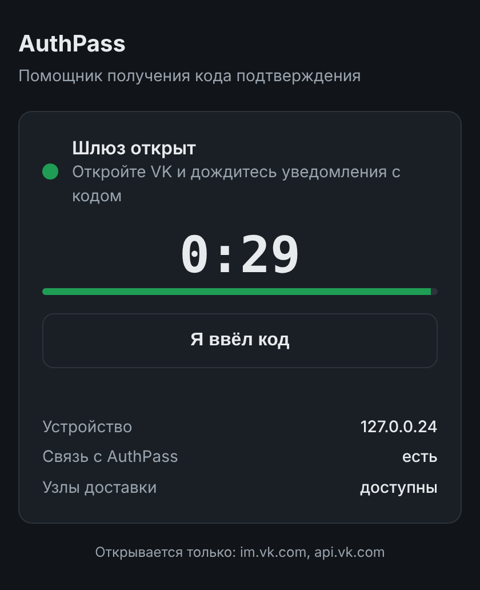

<div align="center">

# 🛡️ AuthPass

**2FA-Gatekeeper для закрытых сетей без сотовой связи**

Открывает на роутере окно на 60 секунд только для одного устройства и только
к узлам доставки кода подтверждения, а потом сам его закрывает.

[](https://github.com/moggiler0x/NoNetPass/actions/workflows/tests.yml)


</div>

## Проблема

В изолированных сетях (корпоративные контуры, учебные полигоны, удалённые
объекты) трафик жёстко фильтруется на роутере, а мобильной связи нет.
Пользователь входит через разрешённый SSO-шлюз (`id.vk.com`), платформа
просит 2FA-код и отправляет его во внутренний мессенджер (`vk.com`). Этот
домен закрыт файрволом, SMS не дойдёт, и пользователь оказывается в тупике,
пока администратор вручную не откроет доступ.

## Решение

AuthPass замечает, что устройство начало верификацию, и по кнопке открывает
для него короткое окно к узлам доставки (`im.vk.com`, `api.vk.com`). Код
приходит, пользователь его вводит, и окно закрывается. Периметр при этом не
меняется: соседние устройства и остальные сайты остаются закрытыми,
администратор не нужен.



## Как это выглядит

| | | |
|:-:|:-:|:-:|
|  |  |  |
| **Шлюз закрыт.** Обычное состояние контура | **Вход обнаружен.** Устройство обратилось к `id.vk.com` | **Шлюз открыт.** Таймер, узлы доставки доступны |
|  |  |  |
| **Код введён.** Доступ закрыт сразу | **Защита от злоупотреблений.** Пауза между окнами | **Тёмная тема.** Подстраивается под систему |

Панель работает по WebSocket и обновляется без перезагрузки. Она действует
только для IP того устройства, с которого её открыли, поэтому открыть окно
для чужого устройства из неё нельзя.

## Проверено на стенде

`lab/run_lab.py` поднимает в отдельном network namespace «роутер» на
настоящем nftables ядра Linux, HTTPS-серверы `im.vk.com` и `api.vk.com`,
три «устройства» и AuthPass с драйвером `nftables`. Затем проходит
сценарий в Chromium и проверяет доступ с каждого устройства. Скриншоты выше
сняты этим стендом. Он же запускается в CI.

```text
1. Устройство в закрытом контуре, окно закрыто
  127.0.0.23  → im.vk.com: заблокирован (ConnectError)
  127.0.0.99  → im.vk.com: заблокирован (ConnectError)

2. Пользователь открывает id.vk.com (запрос виден в логе dnsmasq)
  панель: Обнаружен вход через id.vk.com

3. Пользователь нажимает «Получить код»
  127.0.0.23  → im.vk.com: ДОСТУПЕН (Код подтверждения VK: 482913)
  127.0.0.99  → im.vk.com: заблокирован (ConnectError)
  nft authpass_clients: 127.0.0.23 (timeout 40s)

4. Код получен, пользователь нажимает «Я ввёл код»
  127.0.0.23  → im.vk.com: заблокирован (ConnectError)
  nft authpass_clients: пусто

5. Повторное открытие сразу же (защита от злоупотреблений)
  панель: повторное открытие через 15 с

6. Окно истекает само: устройство 127.0.0.24, окно 30 с, ничего не нажимает
  сразу:      127.0.0.24 → im.vk.com: ДОСТУПЕН (Код подтверждения VK: 482913)
  через 30 с: 127.0.0.24 → im.vk.com: заблокирован (ConnectError)

7. Журнал сессий (/api/admin/journal)
  18:39:16  127.0.0.23  detected, источник dnsmasq
  18:39:16  127.0.0.23  opened
  18:39:16  127.0.0.23  closed (code_entered)
  18:39:17  127.0.0.24  detected, источник panel
  18:39:17  127.0.0.24  opened
  18:39:47  127.0.0.24  closed (expired)
```

Полный вывод: [`docs/screenshots/lab-report.txt`](docs/screenshots/lab-report.txt).
Запустить у себя (нужен root, файрвол хоста не трогается):

```sh
pip install -e . playwright pillow && python -m playwright install chromium
sudo unshare -nm python3 lab/run_lab.py
```

## Возможности

- **Детекция сессии.** По логу запросов dnsmasq (встроено), вебхуком
  `POST /api/detect` от прокси, своего DNS или агента на устройстве, или
  кнопкой в панели.
- **JIT Whitelisting.** IP устройства добавляется в список `authpass-clients`
  на роутере. Разовое правило разрешает трафик из этого списка только к узлам
  доставки.
- **Auto-Revoke.** Окно закрывается по кнопке «Я ввёл код», по таймеру, при
  остановке сервиса или администратором. Если роутер не ответил, откат
  повторяется. Где роутер поддерживает таймаут записи, окно закроется даже
  при падении AuthPass.
- **Журнал сессий.** Каждое изменение состояния пишется в JSON Lines.
- **Ограничения.** Одно окно на устройство, пауза между окнами, лимит в час,
  строгая проверка IPv4 перед любой командой роутеру.

## Роутеры

AuthPass запускается **прямо на роутере** или **на отдельной машине**
(Raspberry Pi, сервер, контейнер), которая управляет роутером по API.

| Роутер | На роутере | С отдельной машины | Таймаут на роутере |
|---|---|---|:-:|
| **MikroTik** RouterOS 7 | контейнер ([инструкция](deploy/mikrotik/container.md)) | `mikrotik` (REST) | ✅ |
| **MikroTik** RouterOS 6 | — | `mikrotik-api` (API 8728/8729) | ✅ |
| **Keenetic** | Entware + `ipset` ([инструкция](deploy/keenetic/README.md)) | `keenetic` (RCI) | ✅ / ❌\* |
| **OpenWrt** 22.03+ | `nftables` ([инструкция](deploy/openwrt/README.md)) | `openwrt` (ubus) | ✅ |
| **ASUS Merlin, DD-WRT**, OpenWrt fw3, Linux с iptables | `ipset` | — | ✅ |
| **OPNsense** | — | `opnsense` (API, алиас) | ❌\* |

\* Без таймаута на роутере окно закрывает только AuthPass, с повторами.
У Keenetic через RCI правила не сохраняются в startup-config и чистятся при
следующем старте AuthPass.

Конфиги для разовой настройки роутера лежат в [`deploy/`](deploy/):
[MikroTik `.rsc`](deploy/mikrotik/authpass.rsc),
[OpenWrt fw4 и procd](deploy/openwrt/),
[Keenetic Entware](deploy/keenetic/),
[systemd](deploy/systemd/authpass.service), [`Dockerfile`](Dockerfile).

> На роутерах с MIPS FastAPI не ставится (нет сборок pydantic-core). Для них
> AuthPass запускается на отдельной машине, а роутер управляется по API.

## Быстрый старт

```sh
pip install .
cp deploy/authpass.env.example .env   # драйвер и доступ к роутеру
set -a; . ./.env; set +a
authpass --port 8080                  # панель: http://<адрес>:8080/
```

Docker: `docker build -t authpass . && docker run --env-file .env -p 8080:8080 authpass`.

Без роутера: `AUTHPASS_DRIVER=mock authpass`, окна открываются в памяти.

## Настройки

| Переменная | По умолчанию | Что задаёт |
|---|---|---|
| `AUTHPASS_DRIVER` | `mock` | драйвер роутера |
| `AUTHPASS_ROUTER_URL`, `_USER`, `_PASSWORD` | | доступ к роутеру (для OPNsense: API key и secret) |
| `AUTHPASS_ROUTER_VERIFY_TLS` | `true` | проверять сертификат роутера |
| `AUTHPASS_CLIENT_LIST` | `authpass-clients` | список клиентов (для nft и ipset `-` меняется на `_`) |
| `AUTHPASS_WINDOW_SECONDS` | `60` | длительность окна |
| `AUTHPASS_GATEWAY_HOSTS` | `id.vk.com` | узлы SSO, с которых начинается сессия |
| `AUTHPASS_TARGET_HOSTS` | `im.vk.com,api.vk.com` | узлы доставки кода |
| `AUTHPASS_COOLDOWN_SECONDS`, `_MAX_OPENS_PER_HOUR` | `15`, `6` | ограничения |
| `AUTHPASS_DETECT_TOKEN`, `AUTHPASS_ADMIN_TOKEN` | | Bearer-токены |
| `AUTHPASS_DNS_LOG_PATH` | | лог dnsmasq для детекции |
| `AUTHPASS_TRUST_FORWARDED` | `false` | брать IP из `X-Forwarded-For` |
| `AUTHPASS_DRIVER_OPT_*` | | опции драйвера: `FAMILY`, `TABLE`, `TARGETS_SET`, `ACL`, `GRANT_CMD`, `REVOKE_CMD`, `STATE_FILE` |

> Если код приходит push-уведомлением в мобильное приложение, а не в веб-чат,
> добавьте в `AUTHPASS_TARGET_HOSTS` узлы push-сервиса (например,
> `mtalk.google.com` для Android).

## API

| Метод | Путь | Доступ |
|---|---|---|
| GET | `/` | панель пользователя |
| WS | `/ws` | события сессии для IP устройства |
| GET | `/api/me` | состояние для IP устройства |
| POST | `/api/me/open` | открыть окно для своего IP |
| POST | `/api/me/done` | код введён, закрыть окно |
| POST | `/api/detect` | детекция `{client_ip, host, source}`, токен детекции |
| GET | `/api/admin/sessions`, `/api/admin/journal` | админ |
| POST | `/api/admin/sessions/{id}/revoke` | админ |
| WS | `/ws/admin?token=…` | все события |
| GET | `/healthz` | статус и связь с роутером |

## Устройство проекта

```text
authpass/
  app.py          FastAPI: панель, REST, WebSocket
  sessions.py     сессии, таймеры, откат, лимиты
  detect.py       детекция по логу dnsmasq
  journal.py      журнал сессий (JSON Lines)
  drivers/        mikrotik, keenetic, openwrt, opnsense, local (nftables, ipset), mock
  static/         панель
deploy/           конфиги роутеров, systemd
lab/              стенд на настоящем nftables
tests/            pytest
```

## Разработка

```sh
pip install -e '.[dev]'
pytest
```

## Дальше

- **Headless Relay.** Сервер сам забирает код через изолированный шлюз и
  показывает его в панели, не открывая доступ устройству.
- Проверка драйверов на реальном железе MikroTik, Keenetic и OpenWrt.
