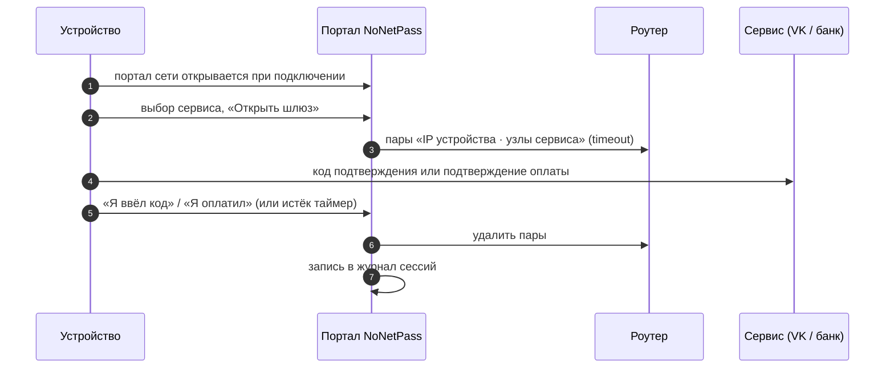
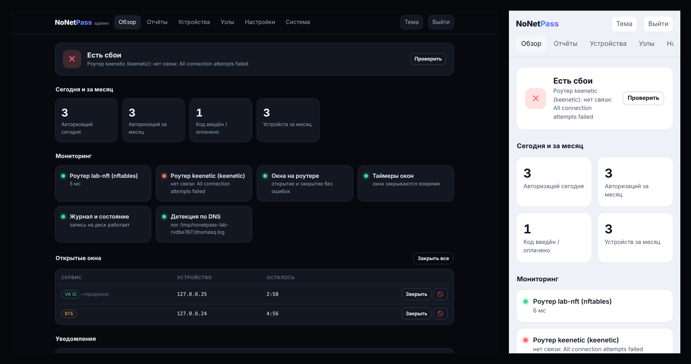
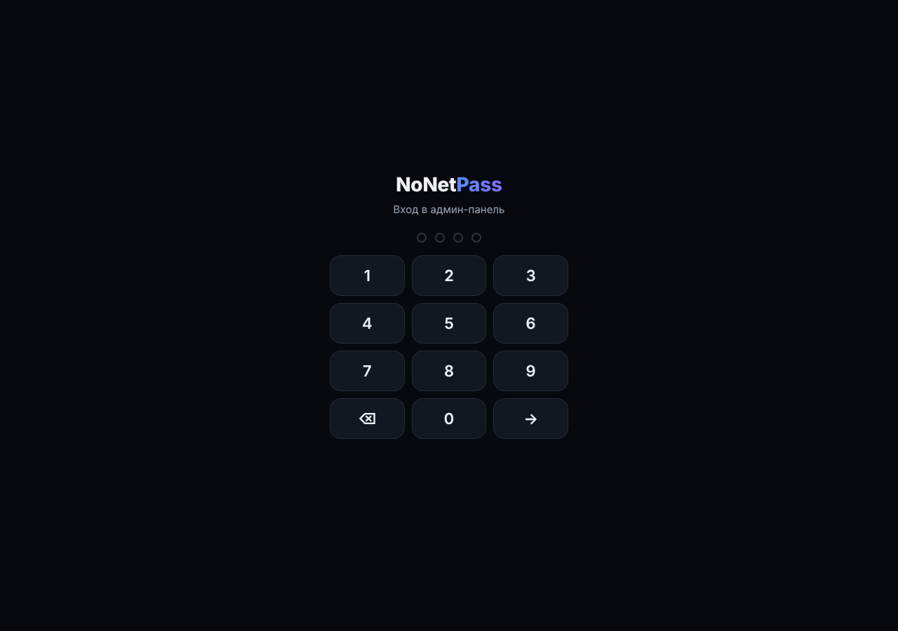
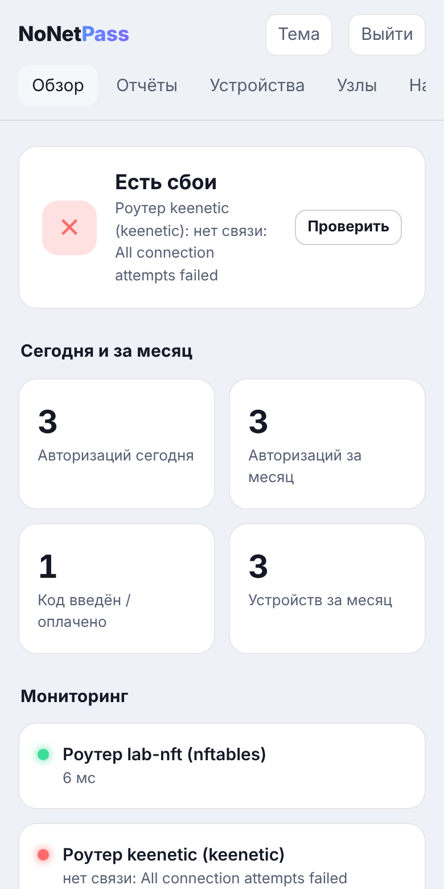
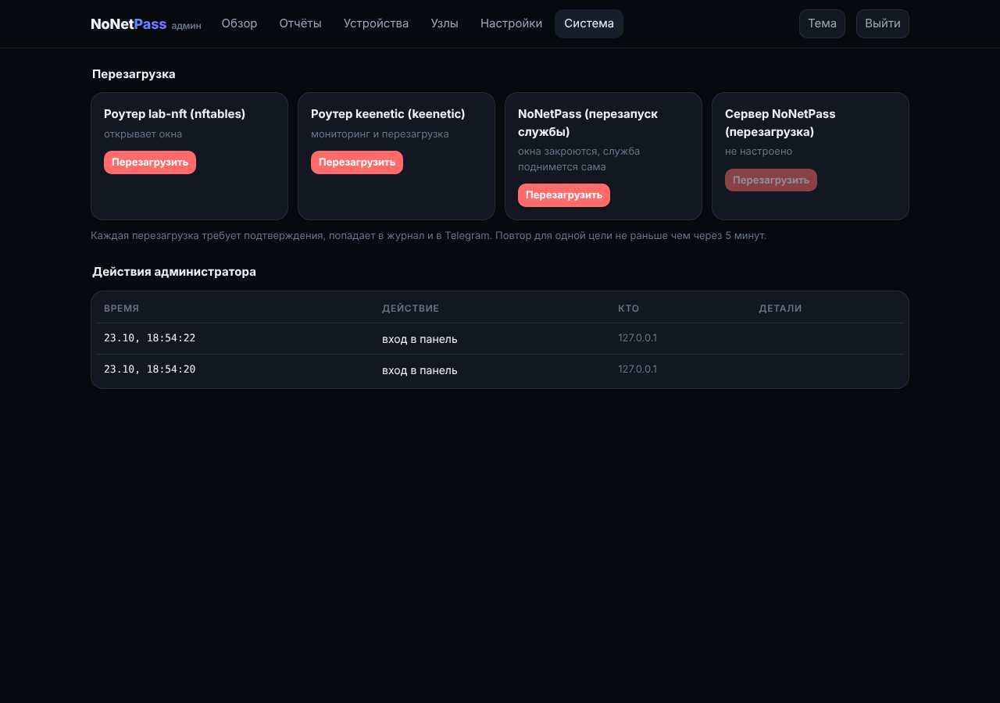

<div align="center">

# 🛡️ NoNetPass

**🇷🇺 [Русский](#-русский) · 🇬🇧 [English](#-english)**

[](https://github.com/moggiler0x/NoNetPass/actions/workflows/tests.yml)


<table>
<tr>
<td width="50%" valign="top">

<b>🇷🇺 Русский</b>

**Шлюз для входа и оплаты в сетях без мобильной связи.** Пользователь
выбирает сервис в портале сети, и роутер открывает окно только для его
устройства и только к узлам этого сервиса: 2 минуты на пуш или код
подтверждения, 5 минут на оплату.

➜ [Суть проекта](#суть-проекта)<br>
➜ [Админ-панель и Telegram-бот](#админ-панель)<br>
➜ [Установка одной командой](#установка-одной-командой)<br>
➜ [Установка портала на ClientPulse](#установка-на-clientpulse)

</td>
<td width="50%" valign="top">

<b>🇬🇧 English</b>

**A sign-in and payment gate for networks without mobile service.** The
user picks a service on the network portal, and the router opens a window
for that device only and only to that service's hosts: 2 minutes for a
push or confirmation code, 5 minutes for a payment.

➜ [What it is](#what-it-is)<br>
➜ [Admin panel and Telegram bot](#admin-panel-and-telegram-bot)<br>
➜ [One-command install](#one-command-install)<br>
➜ [ClientPulse portal setup](#clientpulse-portal-setup)

</td>
</tr>
</table>

</div>

## 🇷🇺 Русский

## Суть проекта

### Проблема

В изолированных сетях (корпоративные контуры, учебные полигоны, удалённые
объекты) трафик жёстко фильтруется на роутере, а мобильной связи нет.
Пользователь входит через разрешённый SSO-шлюз (VK ID, Сбер ID, Яндекс ID,
Альфа ID, Госуслуги), и сервис просит код подтверждения, который приходит в
заблокированное приложение. С оплатой то же самое: банк просит подтвердить
платёж, но его узлы закрыты, а SMS не дойдёт. Без администратора
пользователь застревает.

### Решение

NoNetPass открывается вместе с порталом сети (captive portal). Пользователь
выбирает сервис, и роутер на время окна пропускает трафик этого
устройства к узлам выбранного сервиса: 2 минуты, чтобы пришёл пуш или
код, и 5 минут на подтверждение оплаты. Код пришёл или платёж подтверждён,
и окно закрывается. Соседние устройства, другие сервисы и остальной интернет
всё это время остаются закрытыми.

| Шлюз | Сервисы | Окно |
|---|---|:-:|
| **Вход в сеть** | VK ID, Сбер ID, Яндекс ID, Альфа ID, Госуслуги | **2 мин** |
| **Оплата** | Сбер, Альфа-Банк, ВТБ, Т-Банк | **5 мин** |



## Как это выглядит

| | | |
|:-:|:-:|:-:|
|  |  |  |
| **Портал сети.** Заставка раскрывается при прокрутке | **Выбор сервиса.** Вход в сеть и оплата | **Вход обнаружен.** Устройство открыло `id.vk.com` |
|  |  |  |
| **Шлюз VK открыт.** Подсказки по шагам, таймер, «Продлить» | **Код введён.** Доступ закрыт сразу | **Оплата ВТБ.** 5 минут, светлая тема |

Портал работает без интернета и без внешних библиотек: в закрытой сети CDN
недоступен, поэтому всё встроено в одну страницу. Он обновляется по
WebSocket и действует только для IP устройства, с которого открыт. Тема
переключается кнопкой в углу (как в системе, светлая, тёмная), а по HTTPS
портал ставится на главный экран как приложение (PWA).

## Проверено на стенде

`lab/run_lab.py` поднимает в отдельном network namespace «роутер» на
настоящем nftables ядра Linux, HTTPS-серверы VK и ВТБ, четыре «устройства»,
NoNetPass с драйвером `nftables` и второй, недоступный роутер Keenetic для
проверки мониторинга. Сценарий проходит в Chromium, доступ
проверяется с каждого устройства к каждому сервису. Скриншоты выше сняты
этим стендом, он же запускается в CI.

```text
3. Сервис просит код, пользователь нажимает «Открыть шлюз на 2 мин»
  127.0.0.23  → im.vk.com   ДОСТУПЕН (Код подтверждения VK: 482913)
  127.0.0.23  → 3ds.vtb.ru  заблокирован (ConnectError)     ← другой сервис закрыт
  127.0.0.99  → im.vk.com   заблокирован (ConnectError)     ← соседнее устройство закрыто

7. Окна истекают сами: 127.0.0.25 открывает «VK», продлевает один раз
  127.0.0.25 нажимает «Продлить на 1 мин (один раз)»
  после 3 мин:    127.0.0.25 → im.vk.com  заблокирован (ConnectError)

8. Админ-панель: вход по PIN, открытые окна, мониторинг
  открытых окон в панели: 2; статус: Есть сбои
  уведомление: Роутер keenetic (keenetic): нет связи: All connection attempts failed

9. Отчёт об авторизациях за сегодня
  авторизаций: 3 (вход 2, оплата 1), код введён: 1, истекло: 2, продлений: 1

10. Автооткат после сбоя: окно открыто, NoNetPass убит через kill -9
  после падения:     127.0.0.23 → im.vk.com  ДОСТУПЕН (Код подтверждения VK: 482913)
  после перезапуска: 127.0.0.23 → im.vk.com  заблокирован (ConnectError)
  nft nonetpass_pairs: пусто
```

Полный вывод: [`docs/screenshots/lab-report.txt`](docs/screenshots/lab-report.txt).
Запустить у себя (нужен root, файрвол хоста не трогается):

```sh
pip install -e . playwright pillow && python -m playwright install chromium
sudo unshare -nm python3 lab/run_lab.py
```

## Возможности

- **Портал сети.** Открывается вместе с captive portal, показывает сервисы
  входа и оплаты, таймер окна и доступность узлов.
- **Детекция сессии.** По логу запросов dnsmasq, по syslog роутера
  (DNS-лог MikroTik или dnsmasq OpenWrt и Keenetic на UDP-порт
  `NONETPASS_SYSLOG_PORT`), вебхуком `POST /api/detect` от прокси или агента,
  или выбором в портале. По узлу запроса NoNetPass сам определяет сервис, и
  портал устройства сразу показывает нужный шлюз.
- **Точное окно.** Доступ открывается только для пары «устройство · узлы
  выбранного сервиса». Окно VK не открывает банк, окно банка не открывает VK.
- **Auto-Revoke.** Окно закрывается по кнопке, по таймеру, при остановке
  сервиса или администратором. Если роутер не ответил, откат повторяется.
  Где роутер поддерживает таймаут записи, окно закроется даже при падении
  NoNetPass.
- **Продление.** Если код не успел прийти, окно можно один раз продлить
  (по умолчанию на минуту). Таймер в портале краснеет за 20 секунд до конца.
- **Автооткат при перезапуске.** Открытые окна записываются в файл
  состояния. Если NoNetPass упал или его перезапустили, при старте он
  удаляет их с роутера и пишет в журнал причину `restart`.
- **Ограничения.** Одно окно на устройство, пауза между окнами, лимит в час
  по MAC (если роутер его отдаёт, иначе по IP), чёрный список MAC и IP,
  строгая проверка IPv4 перед любой командой роутеру.
- **Журнал сессий** в JSON Lines с выгрузкой в CSV за любой период.
- **Админ-панель** с входом по PIN, мониторингом, отчётами и перезагрузкой,
  **Telegram-бот** администратора, **метрики** для Prometheus и Grafana.

## Админ-панель



Панель открывается по адресу `http://<адрес>:8080/admin`. Вход по PIN
(`NONETPASS_ADMIN_PIN`, удобная цифровая клавиатура на телефоне) или по
логину и паролю (`NONETPASS_ADMIN_USER`, `NONETPASS_ADMIN_PASSWORD`). После
пяти неверных попыток адрес блокируется на 5 минут. Панель можно закрыть от
гостевой сети: `NONETPASS_ADMIN_NETWORKS=192.168.88.0/24`.

| | | |
|:-:|:-:|:-:|
|  |  |  |
| **Вход по PIN** | **Обзор с телефона** | **Перезагрузка** с подтверждением |

| Раздел | Что там |
|---|---|
| **Обзор** | статус системы, авторизации за сегодня и месяц, проверки мониторинга, открытые окна с кнопками «Закрыть» и «В чёрный список», лента уведомлений |
| **Отчёты** | число авторизаций за месяц, прошлый месяц, 7 или 30 дней или свой период: вход и оплата, подтверждённые, истёкшие, устройства, по сервисам и по дням; выгрузка отчёта и журнала в CSV |
| **Устройства** | чёрный список MAC и IP, последние сессии с MAC |
| **Узлы** | проверка каждого узла каталога: резолвится ли имя, открыт ли порт 443 |
| **Настройки** | длительность окон входа и оплаты, продление, пауза, лимит в час (меняются на лету и сохраняются), статус Telegram-бота и тестовое сообщение |
| **Система** | перезагрузка роутеров, перезапуск NoNetPass, перезагрузка сервера; журнал действий администратора |

### Мониторинг и уведомления

NoNetPass каждые 30 секунд проверяет себя и при любой смене статуса
присылает уведомление в панель и администратору в Telegram (и второе, когда
всё вернулось в норму):

| Проверка | Сбой, если |
|---|---|
| **Роутер** (каждый: основной и дополнительные) | не отвечает два раза подряд, ошибка входа или API |
| **Окна на роутере** | роутер не открыл окно или не закрыл его (сообщение приходит сразу) |
| **Таймеры окон** | окно открыто дольше своего срока |
| **Журнал и состояние** | нельзя писать на диск |
| **Детекция по DNS** | нет лога dnsmasq или не открылся порт syslog |
| **Telegram-бот** | нет связи с `api.telegram.org` |

### Telegram-бот

Бот присылает уведомления о сбоях, ежемесячный отчёт и выполняет команды
администратора. Он слушает только чаты из `NONETPASS_TELEGRAM_ADMIN_IDS`;
в групповом чате из списка команды принимаются только от пользователей,
чей id тоже в списке. Всем остальным бот отвечает «нет доступа» и показывает
их chat_id, а попытка пишется в журнал.

1. Создайте бота у [@BotFather](https://t.me/BotFather) и получите токен.
2. Напишите своему боту любое сообщение: он ответит вашим chat_id.
3. Впишите оба значения в файл настроек и перезапустите NoNetPass:

```sh
NONETPASS_TELEGRAM_TOKEN=123456:ABC...
NONETPASS_TELEGRAM_ADMIN_IDS=111111111,222222222
```

Машине с NoNetPass нужен доступ к `api.telegram.org:443` (одно правило на
роутере для её адреса) или прокси `NONETPASS_TELEGRAM_PROXY`.

| Команда | Что делает |
|---|---|
| `/status`, `/check` | состояние всех проверок, открытые окна, время работы |
| `/alerts` | последние уведомления |
| `/windows` | открытые окна с кнопками «Закрыть» и «Закрыть все» |
| `/report` | отчёт за текущий месяц; `/report prev`, `/report 2026-09`, `/report 7d`, `/report 2026-10-01 2026-10-15` |
| `/hosts` | проверка узлов шлюзов |
| `/reboot` | выбор цели: роутер, перезапуск NoNetPass, перезагрузка сервера |
| `/block`, `/unblock`, `/blocklist` | чёрный список по MAC или IP |

**Перезагрузка** выполняется только после кнопки «Да, перезагрузить»,
которая действует 60 секунд и только для того, кто вызвал команду. Одну и
ту же цель нельзя перезагрузить чаще раза в 5 минут. Каждая перезагрузка
пишется в журнал и рассылается остальным администраторам.

| Цель | Как | Что нужно на роутере |
|---|---|---|
| MikroTik | REST `POST /system/reboot` или API `/system/reboot` | право `reboot` у группы `nonetpass` (есть в `nonetpass.rsc`) |
| Keenetic | RCI `system reboot` | пользователь с правом на CLI |
| OpenWrt | ubus `system reboot` | `system: reboot` в ACL rpcd ([`nonetpass.acl.json`](deploy/openwrt/nonetpass.acl.json)) |
| OPNsense | API `core/system/reboot` | ключ с правом на System |
| NoNetPass на роутере (`nftables`, `ipset`) | команда `reboot` | запуск от root |
| NoNetPass | процесс завершается, окна закрываются, Docker или systemd поднимают его снова | — |
| Сервер NoNetPass | `NONETPASS_HOST_REBOOT_CMD`, например `sudo /usr/bin/systemctl reboot` | правило sudo для пользователя `nonetpass` |

> ⚠️ Команды перезагрузки собраны по документации RouterOS, NDMS, OpenWrt и
> OPNsense и проверены на эмуляторах API в тестах, но **на живых роутерах
> ещё не проверялись**. Перед тем как полагаться на них, проверьте один раз
> на своём железе в спокойное время.

Чтобы бот мог перезагружать и второй роутер (например, Keenetic на входе и
MikroTik с Hotspot), добавьте его только для мониторинга и перезагрузки:

```sh
NONETPASS_ROUTERS=keenetic
NONETPASS_ROUTER_KEENETIC_DRIVER=keenetic
NONETPASS_ROUTER_KEENETIC_URL=http://192.168.1.1
NONETPASS_ROUTER_KEENETIC_USER=admin
NONETPASS_ROUTER_KEENETIC_PASSWORD=...
```

### Отчёты об авторизациях

Авторизация — это открытое окно шлюза. Отчёт считает их по журналу сессий:
всего, вход в сеть и оплата, сколько закончились введённым кодом или
оплатой, сколько истекли, сколько закрыл администратор, уникальные
устройства, продления, ошибки роутера, разбивку по сервисам и по дням.

- **Раз в месяц** 1-го числа в 9:00 (`NONETPASS_REPORT_DAY`,
  `NONETPASS_REPORT_HOUR`, `NONETPASS_TIMEZONE`) отчёт за прошлый месяц
  приходит в Telegram. Если NoNetPass в это время был выключен, отчёт
  придёт после запуска; дважды один месяц не отправляется.
- **По запросу** за любой промежуток: `/report …` в боте, раздел «Отчёты»
  в панели (с выгрузкой CSV) или `GET /api/admin/report?start=2026-10-01&end=2026-10-15`.

### Метрики и Grafana

`GET /metrics` отдаёт метрики Prometheus: события сессий по шлюзам, причины
закрытия, отказы, открытые окна, статус проверок, доступность и время
ответа роутеров. Готовый дашборд: [`deploy/grafana/nonetpass.json`](deploy/grafana/nonetpass.json).
Prometheus и Grafana поднимаются вместе с NoNetPass одной командой
`docker compose --profile monitoring up -d` (Grafana на порту 3000).
Доступ к метрикам можно закрыть токеном `NONETPASS_METRICS_TOKEN`.

## Установка одной командой

```sh
git clone -b ClientPulse https://github.com/moggiler0x/NoNetPass.git
cd NoNetPass && sudo ./install.sh
```

Скрипт ставит NoNetPass в Docker (`docker compose`), а если Docker нет, то в
`/opt/nonetpass/.venv` со службой systemd (`--docker` и `--native`
выбирают явно). Файл настроек (`.env` для Docker, `/etc/nonetpass.env` для
службы) создаётся из [примера](deploy/nonetpass.env.example) со случайным
PIN админ-панели, который скрипт печатает в конце. Драйвер по умолчанию
`mock`: впишите в файл свой роутер и токен бота и перезапустите. Секретов в
репозитории нет, всё задаётся только через окружение.

Образ также собирается в CI и публикуется после merge как
`ghcr.io/moggiler0x/nonetpass:clientpulse` (`linux/amd64`, `linux/arm64`).

## Роутеры

NoNetPass запускается **прямо на роутере** или **на отдельной машине**
(Raspberry Pi, сервер, контейнер), которая управляет роутером по API.

| Роутер | На роутере | С отдельной машины | Как задано окно | Таймаут на роутере |
|---|---|---|---|:-:|
| **MikroTik** RouterOS 7, Captive Portal провайдера | контейнер ([инструкция](deploy/mikrotik/README.md)) | `mikrotik` (REST) | список на шлюз, walled garden ip | ✅ |
| **MikroTik** RouterOS 6 | — | `mikrotik-api` (API 8728/8729)\*\* | список на шлюз | ✅ |
| **Keenetic** | Entware + `ipset` ([инструкция](deploy/keenetic/README.md)) | `keenetic` (RCI) | пары / ACL | ✅ / ❌\* |
| **OpenWrt** 22.03+ | `nftables` ([инструкция](deploy/openwrt/README.md)) | `openwrt` (ubus) | пары | ✅ |
| **ASUS Merlin, DD-WRT**, OpenWrt fw3, Linux с iptables | `ipset` | — | пары | ✅ |
| **OPNsense** | — | `opnsense` (API) | алиас на шлюз | ❌\* |

\* Без таймаута на роутере окно закрывает только NoNetPass, с повторами.
\*\* Инструкция провайдера Captive Portal отключает службы `api` и `api-ssl`,
поэтому в такой сети используется драйвер `mikrotik` (REST через `www-ssl`).
У Keenetic через RCI правила не сохраняются в startup-config и чистятся при
следующем старте NoNetPass.

Разовую настройку роутера генерирует сам NoNetPass из каталога шлюзов:

```sh
nonetpass router-config mikrotik  > nonetpass.rsc       # списки, walled garden и правила на каждый шлюз
nonetpass router-config nftables  > /etc/nonetpass/sets.nft
nonetpass router-config ipset     > /opt/etc/ndm/netfilter.d/50-nonetpass.sh
```

Готовые файлы лежат в [`deploy/`](deploy/):
[MikroTik `.rsc` и пошаговая инструкция](deploy/mikrotik/README.md),
[OpenWrt fw4 и procd](deploy/openwrt/),
[Keenetic Entware](deploy/keenetic/),
[systemd](deploy/systemd/nonetpass.service), [`Dockerfile`](Dockerfile).

> На роутерах с MIPS FastAPI не ставится (нет сборок pydantic-core). Для них
> NoNetPass запускается на отдельной машине, а роутер управляется по API.

### MikroTik с Captive Portal провайдера

Настройка MikroTik построена на инструкции провайдера Captive Portal
(Hotspot + RADIUS, страница входа провайдера, сеть `192.168.110.0/24`,
сервер `hotspot1`). Сначала роутер настраивается по шагам 1–6 провайдера,
затем добавляется NoNetPass (пошагово: [Установка на ClientPulse](#установка-на-clientpulse)):

- страницы входа провайдер держит открытыми в walled garden, они служат
  узлами-триггерами шлюзов (`id.vk.ru`, `id.sber.ru`, `passport.yandex.ru`,
  `oauth.yandex.ru`, `id.alfabank.ru`, `*.gosuslugi.ru`);
- окна для гостей, ещё не прошедших вход, открываются правилами
  `/ip hotspot walled-garden ip` по спискам `nonetpass-clients-<шлюз>` с
  таймаутом: Hotspot перехватывает их трафик раньше обычного файрвола;
- портал NoNetPass доступен до входа (`http://nonetpass.lan:8080/`), а
  трафик к нему исключён из masquerade Hotspot, чтобы NoNetPass видел
  настоящий IP устройства;
- службы `api` и `api-ssl` остаются отключёнными, как требует провайдер:
  NoNetPass ходит в роутер через REST по `www-ssl` и только со своего адреса.

## Каталог шлюзов

Каталог по умолчанию лежит в [`nonetpass/gates.py`](nonetpass/gates.py), его
копия для правки — [`deploy/gates.example.json`](deploy/gates.example.json).
Свой каталог подключается через `NONETPASS_GATES_FILE`:

```json
[
  {"id": "vk", "name": "VK", "kind": "verify",
   "gateways": ["id.vk.com"], "targets": ["im.vk.com", "api.vk.com"]},
  {"id": "vtb-pay", "name": "ВТБ", "kind": "pay",
   "gateways": ["3ds.vtb.ru"], "targets": ["3ds.vtb.ru", "api.vtb.ru"]}
]
```

`gateways` — узлы, обращение к которым начинает сессию; `targets` — узлы,
которые открываются на время окна; `kind` — `verify` (2 мин) или `pay` (5 мин).

> Списки узлов по умолчанию собраны по основным доменам сервисов. Перед
> запуском сверьте их со своей сетью: адреса доставки пушей, серверов
> 3-D Secure и API у платформ и банков меняются. Если код приходит
> push-уведомлением в мобильное приложение, добавьте узлы push-сервиса
> (например, `mtalk.google.com` для Android).

## Быстрый старт

```sh
pip install .
cp deploy/nonetpass.env.example .env   # драйвер и доступ к роутеру
set -a; . ./.env; set +a
nonetpass --port 8080                  # портал: http://<адрес>:8080/
```

Docker: `docker compose up -d --build` (настройки в `.env`), или вручную
`docker build -t nonetpass . && docker run --env-file .env -p 8080:8080 -v nonetpass:/data nonetpass`.

Без роутера: `NONETPASS_DRIVER=mock nonetpass`, окна открываются в памяти.

Чтобы портал открывался сам при подключении к Wi-Fi, направьте на него
captive portal роутера (страницу авторизации гостевой сети).

## Настройки

| Переменная | По умолчанию | Что задаёт |
|---|---|---|
| `NONETPASS_DRIVER` | `mock` | драйвер роутера |
| `NONETPASS_ROUTER_URL`, `_USER`, `_PASSWORD` | | доступ к роутеру (для OPNsense: API key и secret) |
| `NONETPASS_ROUTER_VERIFY_TLS` | `true` | проверять сертификат роутера |
| `NONETPASS_VERIFY_WINDOW_SECONDS` | `120` | окно шлюзов входа в сеть |
| `NONETPASS_PAY_WINDOW_SECONDS` | `300` | окно шлюзов оплаты |
| `NONETPASS_GATES_FILE` | | свой каталог шлюзов (JSON) |
| `NONETPASS_CLIENT_LIST` | `nonetpass-clients` | префикс списков MikroTik и алиасов OPNsense |
| `NONETPASS_COOLDOWN_SECONDS`, `_MAX_OPENS_PER_HOUR` | `15`, `6` | пауза между окнами и лимит в час на устройство |
| `NONETPASS_EXTEND_SECONDS`, `_MAX_EXTENDS` | `60`, `1` | «Продлить»: на сколько и сколько раз |
| `NONETPASS_BLOCKED_MACS`, `_BLOCKED_IPS` | | чёрный список из окружения (через запятую) |
| `NONETPASS_ROUTER_NAME` | `main` | имя основного роутера в панели и боте |
| `NONETPASS_ROUTERS` + `NONETPASS_ROUTER_<ИМЯ>_DRIVER`, `_URL`, `_USER`, `_PASSWORD`, `_VERIFY_TLS` | | дополнительные роутеры для мониторинга и перезагрузки |
| `NONETPASS_ADMIN_PIN` или `NONETPASS_ADMIN_USER` + `_PASSWORD` | | вход в админ-панель |
| `NONETPASS_SECRET` | случайный | ключ подписи cookie панели |
| `NONETPASS_ADMIN_NETWORKS` | | подсети, из которых открыта панель |
| `NONETPASS_LOGIN_MAX_FAILURES`, `_LOGIN_LOCKOUT_SECONDS` | `5`, `300` | защита от подбора PIN |
| `NONETPASS_DETECT_TOKEN`, `NONETPASS_ADMIN_TOKEN` | | Bearer-токены для детекции и API |
| `NONETPASS_TELEGRAM_TOKEN`, `_TELEGRAM_ADMIN_IDS` | | бот и chat_id администраторов |
| `NONETPASS_TELEGRAM_PROXY`, `_TELEGRAM_API` | | прокси и адрес Bot API |
| `NONETPASS_HEALTH_INTERVAL_SECONDS`, `_HEALTH_FAIL_AFTER` | `30`, `2` | период проверок и сколько неудач подряд считать сбоем |
| `NONETPASS_TIMEZONE`, `_REPORT_DAY`, `_REPORT_HOUR` | `Europe/Moscow`, `1`, `9` | ежемесячный отчёт |
| `NONETPASS_ALLOW_RESTART` | `true` | перезапуск NoNetPass из бота и панели |
| `NONETPASS_HOST_REBOOT_CMD` | | команда перезагрузки сервера (пусто: выключено) |
| `NONETPASS_REBOOT_COOLDOWN_SECONDS` | `300` | пауза между перезагрузками одной цели |
| `NONETPASS_METRICS_TOKEN` | | токен для `/metrics` |
| `NONETPASS_DNS_LOG_PATH` | | лог dnsmasq для детекции |
| `NONETPASS_SYSLOG_PORT`, `_SYSLOG_ALLOW` | | UDP-порт syslog и адреса роутеров, от которых он принимается |
| `NONETPASS_LOG_PATH`, `NONETPASS_STATE_PATH` | `nonetpass-sessions.jsonl`, `nonetpass-state.json` | журнал и файл состояния |
| `NONETPASS_TRUST_FORWARDED` | `false` | брать IP из `X-Forwarded-For` |
| `NONETPASS_DRIVER_OPT_*` | | опции драйвера: `SET`, `FAMILY`, `TABLE`, `ACL`, `GRANT_CMD`, `REVOKE_CMD`, `STATE_FILE` |

## API

| Метод | Путь | Доступ |
|---|---|---|
| GET | `/` | портал |
| GET | `/api/gates` | каталог шлюзов |
| WS | `/ws` | события сессии для IP устройства |
| GET | `/api/me` | состояние для IP устройства |
| POST | `/api/me/open` | `{gate}`: открыть окно шлюза для своего IP |
| POST | `/api/me/extend` | продлить своё окно (один раз) |
| POST | `/api/me/done` | код введён / платёж подтверждён, закрыть окно |
| POST | `/api/detect` | детекция `{client_ip, host или gate, source}`, токен детекции |
| GET | `/admin` | админ-панель |
| POST | `/api/admin/login`, `/api/admin/logout` | вход `{pin}` или `{user, password}` |
| GET | `/api/admin/overview`, `/health`, `/windows`, `/sessions`, `/journal` | админ |
| POST | `/api/admin/sessions/{id}/revoke`, `/windows/close-all`, `/health/check` | админ |
| PUT | `/api/admin/settings` | окна, продление, пауза, лимит |
| GET | `/api/admin/report`, `/report.csv`, `/journal.csv` | `?period=prev` или `?start=…&end=…` |
| GET, POST, DELETE | `/api/admin/blocklist` | чёрный список |
| GET | `/api/admin/hosts` | проверка узлов |
| GET, POST | `/api/admin/reboot`, `/api/admin/reboot/{цель}` | цели и перезагрузка, `{confirm: цель}` |
| WS | `/ws/admin` | все события и уведомления (cookie панели или `?token=`) |
| GET | `/healthz`, `/metrics` | статус и метрики Prometheus |

Админские запросы принимают cookie панели (изменяющие ещё и заголовок
`X-NoNetPass: 1`) или `Authorization: Bearer <NONETPASS_ADMIN_TOKEN>`.

## Устройство проекта

```text
nonetpass/
  app.py          FastAPI: портал, REST, WebSocket
  admin.py        админ-панель: вход, окна, отчёты, чёрный список, перезагрузка
  telegram.py     бот администратора
  health.py       мониторинг и уведомления
  control.py      роутеры, перезагрузка, перезапуск
  reports.py      отчёты об авторизациях, ежемесячная рассылка
  metrics.py      метрики Prometheus
  hostcheck.py    проверка узлов шлюзов
  gates.py        каталог шлюзов входа и оплаты
  sessions.py     сессии, таймеры, откат, лимиты, продление
  blocklist.py    чёрный список MAC и IP
  store.py        состояние между запусками
  detect.py       детекция по логу dnsmasq и syslog
  journal.py      журнал сессий (JSON Lines, CSV)
  routercfg.py    генерация настройки роутера из каталога
  drivers/        mikrotik, keenetic, openwrt, opnsense, local (nftables, ipset), mock
  static/         портал, админ-панель, PWA
deploy/           конфиги роутеров, systemd, Grafana, пример настроек и каталога
install.sh        установка одной командой
docker-compose.yml
lab/              стенд на настоящем nftables
tests/            pytest
```

## Разработка

```sh
pip install -e '.[dev]'
pytest
```

## Дальше

- **Headless Relay.** Сервер сам забирает код через изолированный шлюз и
  показывает его в портале, не открывая доступ устройству.
- Проверка драйверов, команд перезагрузки и списков узлов на реальном
  железе и в реальных сетях.

## Установка на ClientPulse

Пошаговая установка портала NoNetPass в гостевую сеть ClientPulse на
MikroTik (сценарий «только авторизация», Hotspot + RADIUS, страница входа
`wifi.clientpulse.ru`). Подробности и разбор каждого правила:
[`deploy/mikrotik/README.md`](deploy/mikrotik/README.md).

**Что понадобится**

- MikroTik с RouterOS 7, уже настроенный по инструкции ClientPulse;
- для запуска на самом роутере: пакет `container` и USB-носитель или диск;
  иначе любая машина в сети роутера (Raspberry Pi, мини-ПК, сервер);
- компьютер с Python 3.10+ или Docker, чтобы собрать образ и файл настройки.

**1. Настройте роутер по инструкции ClientPulse.** Выполните её шаги 1–6
как есть: мост `bridge-hotspot`, сеть `192.168.110.1/24`, RADIUS-серверы
ClientPulse, `/ip hotspot setup` с DNS-именем `wf.clientpulse.ru`, профили и
таймауты, walled garden страниц входа (VK ID, Сбер ID, Яндекс ID, Альфа ID,
Госуслуги), файлы `login.html` и остальные, отключение `api` и `api-ssl`.
Проверьте, что гость видит страницу входа ClientPulse.

**2. Соберите NoNetPass.**

```sh
git clone -b ClientPulse https://github.com/moggiler0x/NoNetPass.git
cd NoNetPass
docker buildx build --platform linux/arm64 -t nonetpass .   # linux/arm/v7 или linux/amd64 под свой роутер
docker save nonetpass > nonetpass.tar
```

**3. Запустите NoNetPass.** На роутере: включите контейнеры
(`/system/device-mode/update container=yes`, подтвердите кнопкой), загрузите
`nonetpass.tar` на `usb1/` и выполните команды
[шага 7](deploy/mikrotik/README.md#шаг-7-контейнер-nonetpass-на-роутере):
`veth-nonetpass` с адресом `172.17.0.2`, переменные `NONETPASS_DRIVER=mikrotik`,
`NONETPASS_ROUTER_URL=https://172.17.0.1`, пользователь и пароль `nonetpass`.
На отдельной машине:

```sh
pip install .
cp deploy/nonetpass.env.example .env   # NONETPASS_DRIVER=mikrotik, адрес роутера, пароль
set -a; . ./.env; set +a
nonetpass --port 8080
```

**4. Импортируйте правила NoNetPass.** Сгенерируйте файл под свою сеть
(в `--portal` адрес, где запущен NoNetPass) и загрузите его в Files:

```sh
nonetpass router-config mikrotik --hotspot-server hotspot1 \
    --hotspot-net 192.168.110.0/24 --portal 172.17.0.2:8080 > nonetpass.rsc
```

```
/import nonetpass.rsc
/user set nonetpass password=<свой пароль>
```

Файл добавит списки узлов на каждый шлюз, окна через
`/ip hotspot walled-garden ip`, доступ к порталу до входа и имя
`nonetpass.lan`, исключение из masquerade и REST через `www-ssl` только с
адреса NoNetPass. Пароль из `/user set` впишите в
`NONETPASS_ROUTER_PASSWORD`. Готовый файл со значениями по умолчанию:
[`deploy/mikrotik/nonetpass.rsc`](deploy/mikrotik/nonetpass.rsc).

**5. Дайте гостям ссылку на портал.** Портал открывается по адресу
`http://nonetpass.lan:8080/`. Страница входа остаётся страницей ClientPulse,
поэтому ссылку на NoNetPass разместите рядом: QR-код на табличке, текст в
приветствии ClientPulse или в имени сети.

**6. Проверьте.** Подключитесь к гостевой сети, откройте портал, выберите,
например, VK ID и нажмите «Открыть шлюз на 2 мин». На роутере:

```
/ip hotspot walled-garden ip print where comment~"nonetpass"
/ip firewall address-list print where list~"nonetpass-clients"
```

Во втором списке появится IP устройства с `timeout`, через 2 минуты (у
банков через 5) или после «Я ввёл код» запись исчезнет. Состояние
NoNetPass: `http://nonetpass.lan:8080/healthz`.

> Окна входа и оплаты меняются переменными
> `NONETPASS_VERIFY_WINDOW_SECONDS` (по умолчанию `120`) и
> `NONETPASS_PAY_WINDOW_SECONDS` (`300`). Связка `walled-garden ip` со
> списками адресов собрана по документации RouterOS 7 и инструкции
> ClientPulse; на конкретном роутере её стоит проверить первой.

---

## 🇬🇧 English

## What it is

**The problem.** In isolated networks (corporate segments, training
grounds, remote sites) the router filters traffic hard and there is no
mobile service. A user signs in through an allowed SSO page (VK ID, Sber ID,
Yandex ID, Alfa ID, Gosuslugi), and the service sends a push or a code to an
app that is blocked. Payments hit the same wall: the bank asks to confirm a
payment, its hosts are closed, and an SMS will not arrive.

**The solution.** NoNetPass opens together with the network's captive
portal. The user picks a service, and the router lets that one device reach
that one service's hosts for a short window. Once the code arrives or the
payment is confirmed, the window closes. Other devices, other services and
the rest of the internet stay closed the whole time.

| Gate | Services | Window |
|---|---|:-:|
| **Sign-in** | VK ID, Sber ID, Yandex ID, Alfa ID, Gosuslugi | **2 min** |
| **Payment** | Sber, Alfa-Bank, VTB, T-Bank | **5 min** |

- **Precise windows.** Access is opened only for the pair "device · hosts
  of the chosen service". A VK window does not open a bank, and a bank
  window does not open VK.
- **Auto-revoke.** A window closes on the button, on the timer, on shutdown
  or by an admin. Where the router supports entry timeouts, the window
  closes even if NoNetPass crashes.
- **Detection.** From the dnsmasq query log, a `POST /api/detect` webhook,
  or the user's choice on the portal.
- **Session journal** in JSON Lines, per-device cooldown and hourly limits.
- **Routers:** MikroTik (REST, API, container), Keenetic (RCI, Entware
  ipset), OpenWrt (nftables, ubus), OPNsense, any Linux with nftables or
  ipset. NoNetPass runs on the router itself or on a separate machine.
- **Tested** in `lab/run_lab.py` on real kernel nftables in a network
  namespace, with Chromium driving the portal; the screenshots above come
  from that lab, and it runs in CI.

- **Extend once.** If the code is late, the user can extend the window once
  (a minute by default). Windows left open by a crash or restart are removed
  from the router on startup and logged with the reason `restart`.
- **Limits and blocklist.** Hourly limit and cooldown per device (by MAC when
  the router reports it), MAC and IP blocklist.

## Admin panel and Telegram bot


- **Admin panel** at `/admin`, PIN or login and password, lockout after five
  wrong attempts, optional subnet allowlist. System status, open windows
  with close and block buttons, reports, blocklist, host check, window
  durations and limits changed on the fly, reboot with confirmation, and the
  admin action log.
- **Health monitoring** of every router, driver errors (a window not opened
  or not closed), overdue windows, disk, DNS detection and the bot. Every
  status change becomes a notification in the panel and in Telegram, plus a
  second one when things recover.
- **Telegram bot** for the admins listed in `NONETPASS_TELEGRAM_ADMIN_IDS`
  only: `/status`, `/alerts`, `/windows`, `/report`, `/hosts`, `/block`,
  `/reboot`. A reboot of a router (MikroTik, Keenetic, OpenWrt, OPNsense),
  of NoNetPass itself or of its server runs only after a confirmation button
  valid for 60 seconds for the admin who asked, at most once per 5 minutes
  per target, and is logged. Strangers get "no access" and their chat_id.
- **Reports** on the number of authorizations (opened windows): sent to
  Telegram on the 1st of every month for the previous month, and on demand
  for any period in the bot (`/report 2026-10-01 2026-10-15`) and the panel,
  with CSV export.
- **Metrics** for Prometheus at `/metrics` and a ready Grafana dashboard
  (`docker compose --profile monitoring up -d`).

> ⚠️ The reboot commands follow the RouterOS, NDMS, OpenWrt and OPNsense
> docs and are tested against API emulators, but **have not been run on
> live routers yet**. Try them once on your own hardware first.

Tokens and chat ids are set only through environment variables; the
repository has no secrets.

## One-command install

```sh
git clone -b ClientPulse https://github.com/moggiler0x/NoNetPass.git
cd NoNetPass && sudo ./install.sh
```

Docker (`docker compose`) if available, otherwise a venv in `/opt/nonetpass`
with a systemd service (`--docker` / `--native` to choose). The settings
file is created from the [example](deploy/nonetpass.env.example) with a
random admin PIN printed at the end; the driver starts as `mock` until you
fill in the router and the bot token.

The rest of the documentation (settings, API, gate catalog) is in the
Russian part above; variable names and endpoints are the same.

## ClientPulse portal setup

Step-by-step installation of the NoNetPass portal into a ClientPulse guest
network on MikroTik ("authorization only" scenario, Hotspot + RADIUS,
sign-in page `wifi.clientpulse.ru`). Rule-by-rule details (in Russian):
[`deploy/mikrotik/README.md`](deploy/mikrotik/README.md).

**You need**

- a MikroTik on RouterOS 7, already configured with the ClientPulse guide;
- to run on the router: the `container` package and a USB stick or disk;
  otherwise any machine in the router's network (Raspberry Pi, mini PC,
  server);
- a computer with Python 3.10+ or Docker to build the image and the config.

**1. Configure the router with the ClientPulse guide.** Follow its steps
1–6 as written: `bridge-hotspot`, network `192.168.110.1/24`, the ClientPulse
RADIUS servers, `/ip hotspot setup` with DNS name `wf.clientpulse.ru`,
profiles and timeouts, the walled garden for sign-in pages (VK ID, Sber ID,
Yandex ID, Alfa ID, Gosuslugi), `login.html` and the other files, and
`api`/`api-ssl` disabled. Check that a guest sees the ClientPulse sign-in
page.

**2. Build NoNetPass.**

```sh
git clone -b ClientPulse https://github.com/moggiler0x/NoNetPass.git
cd NoNetPass
docker buildx build --platform linux/arm64 -t nonetpass .   # or linux/arm/v7, linux/amd64 for your router
docker save nonetpass > nonetpass.tar
```

**3. Run NoNetPass.** On the router: enable containers
(`/system/device-mode/update container=yes`, confirm with the button),
upload `nonetpass.tar` to `usb1/` and run the commands from
[step 7](deploy/mikrotik/README.md#шаг-7-контейнер-nonetpass-на-роутере):
`veth-nonetpass` at `172.17.0.2`, `NONETPASS_DRIVER=mikrotik`,
`NONETPASS_ROUTER_URL=https://172.17.0.1`, user `nonetpass` and its password.
On a separate machine:

```sh
pip install .
cp deploy/nonetpass.env.example .env   # NONETPASS_DRIVER=mikrotik, router address, password
set -a; . ./.env; set +a
nonetpass --port 8080
```

**4. Import the NoNetPass rules.** Generate the file for your network
(`--portal` is where NoNetPass runs) and upload it to Files:

```sh
nonetpass router-config mikrotik --hotspot-server hotspot1 \
    --hotspot-net 192.168.110.0/24 --portal 172.17.0.2:8080 > nonetpass.rsc
```

```
/import nonetpass.rsc
/user set nonetpass password=<your password>
```

It adds per-gate host lists, windows via `/ip hotspot walled-garden ip`,
pre-login access to the portal under the name `nonetpass.lan`, a masquerade
exception, and REST over `www-ssl` limited to the NoNetPass address. Put the
password from `/user set` into `NONETPASS_ROUTER_PASSWORD`. A ready file with
the defaults: [`deploy/mikrotik/nonetpass.rsc`](deploy/mikrotik/nonetpass.rsc).

**5. Give guests the portal link.** The portal lives at
`http://nonetpass.lan:8080/`. The sign-in page stays ClientPulse's, so place
the NoNetPass link next to it: a QR code on a sign, the ClientPulse welcome
text, or the network name.

**6. Check it.** Join the guest network, open the portal, pick VK ID, for
example, and press the open button. On the router:

```
/ip hotspot walled-garden ip print where comment~"nonetpass"
/ip firewall address-list print where list~"nonetpass-clients"
```

The device IP shows up in the second list with a `timeout` and disappears
after 2 minutes (5 for banks) or after "I entered the code". NoNetPass
status: `http://nonetpass.lan:8080/healthz`.

> Windows are set by `NONETPASS_VERIFY_WINDOW_SECONDS` (default `120`) and
> `NONETPASS_PAY_WINDOW_SECONDS` (`300`). The `walled-garden ip` rules with
> address lists follow the RouterOS 7 docs and the ClientPulse guide; verify
> them on your router first.
