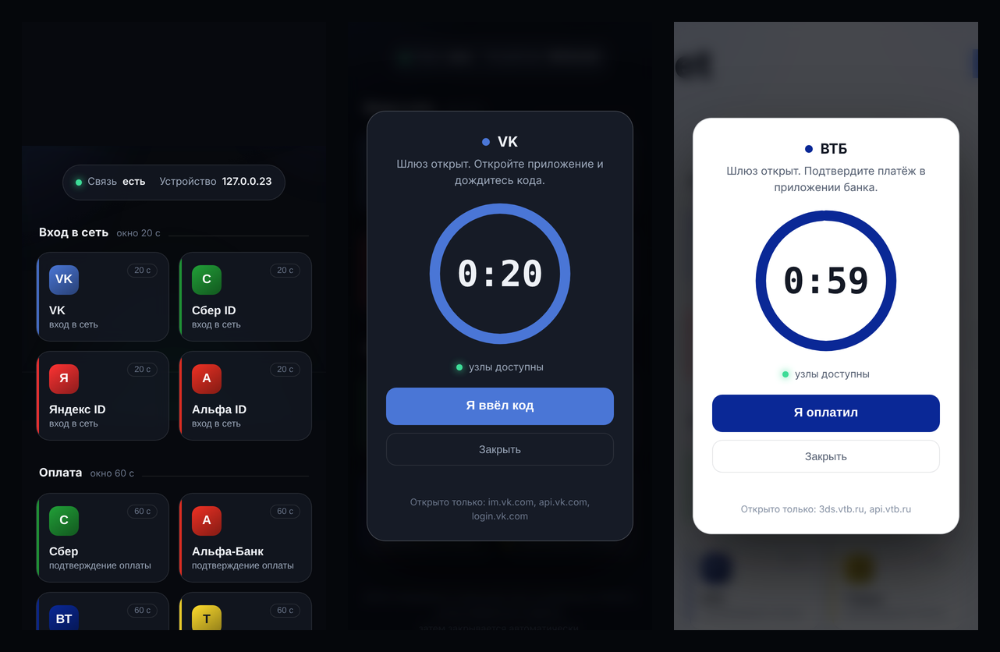
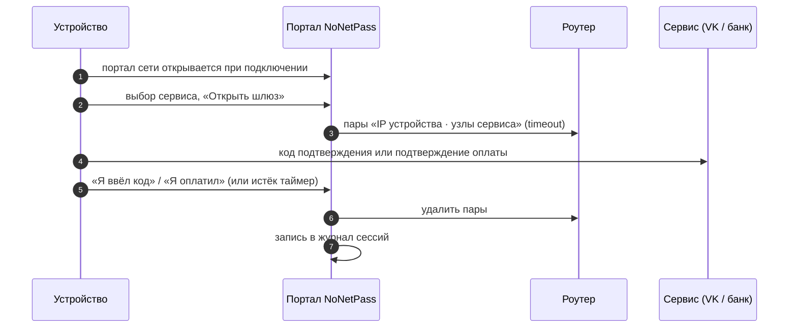
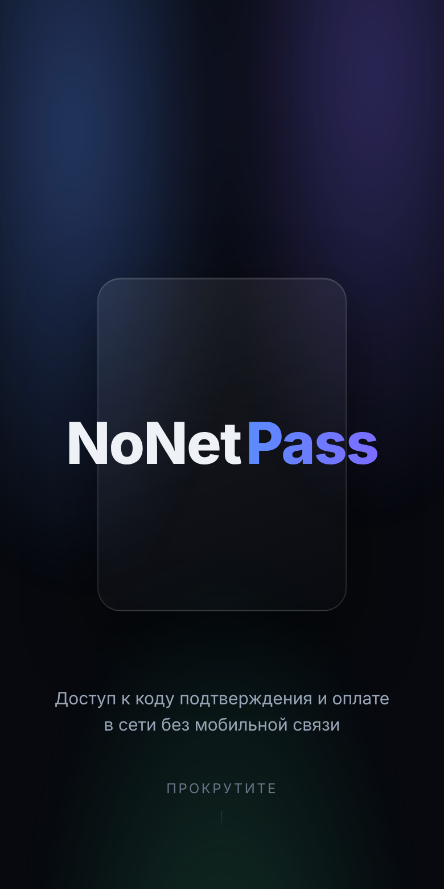
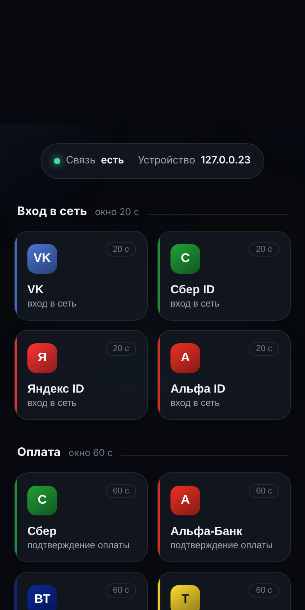
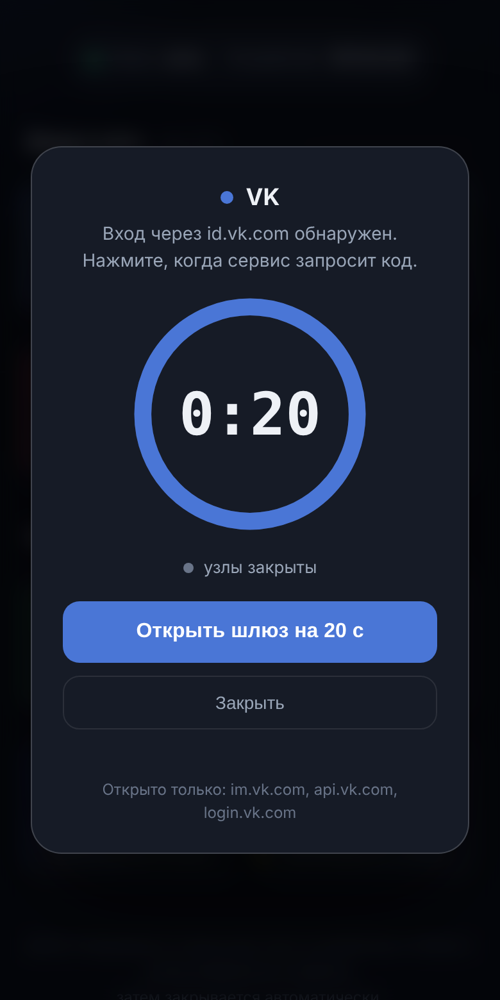
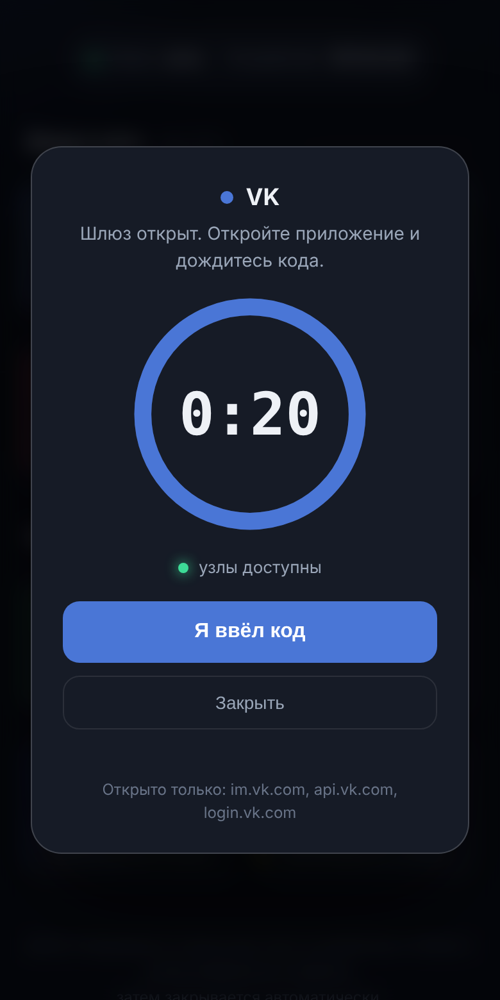
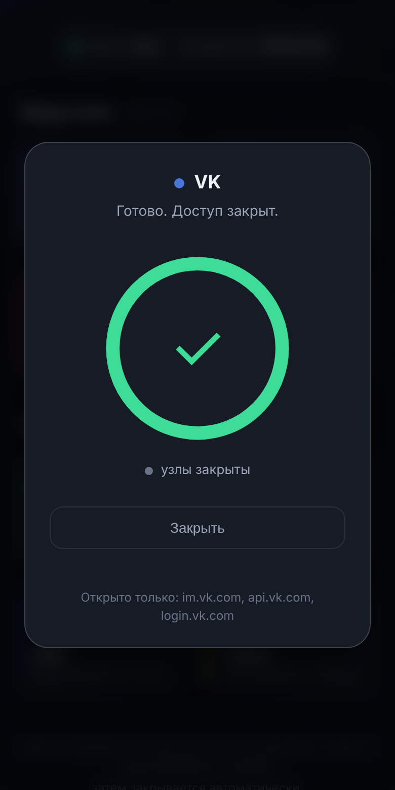
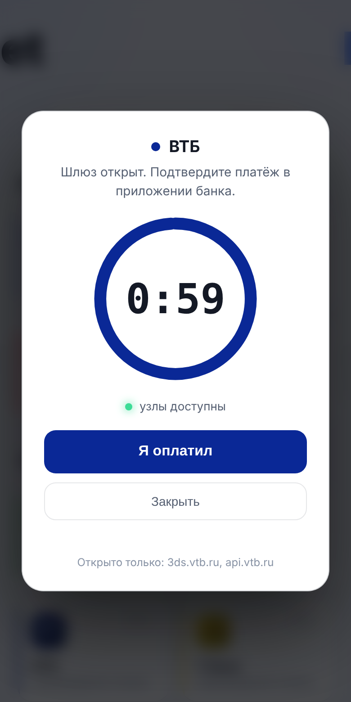

<div align="center">

# 🛡️ NoNetPass

**Шлюз для входа и оплаты в сетях без мобильной связи**

Пользователь выбирает сервис в портале сети, и NoNetPass на роутере открывает
окно только для его устройства и только к узлам этого сервиса: 20 секунд на
код подтверждения, 60 секунд на оплату. Потом окно закрывается само.

[](https://github.com/moggiler0x/NoNetPass/actions/workflows/tests.yml)




</div>

## Проблема

В изолированных сетях (корпоративные контуры, учебные полигоны, удалённые
объекты) трафик жёстко фильтруется на роутере, а мобильной связи нет.
Пользователь входит через разрешённый SSO-шлюз (VK ID, Сбер ID, Яндекс ID,
Альфа ID), и сервис просит код подтверждения, который приходит в
заблокированное приложение. С оплатой то же самое: банк просит подтвердить
платёж, но его узлы закрыты, а SMS не дойдёт. Без администратора
пользователь застревает.

## Решение

NoNetPass открывается вместе с порталом сети (captive portal). Пользователь
выбирает сервис, и роутер на короткое время пропускает трафик этого
устройства к узлам выбранного сервиса. Код пришёл или платёж подтверждён,
и окно закрывается. Соседние устройства, другие сервисы и остальной интернет
всё это время остаются закрытыми.

| Шлюз | Сервисы | Окно |
|---|---|:-:|
| **Вход в сеть** | VK, Сбер ID, Яндекс ID, Альфа ID | **20 с** |
| **Оплата** | Сбер, Альфа-Банк, ВТБ, Т-Банк | **60 с** |



## Как это выглядит

| | | |
|:-:|:-:|:-:|
|  |  |  |
| **Портал сети.** Заставка раскрывается при прокрутке | **Выбор сервиса.** Вход в сеть и оплата | **Вход обнаружен.** Устройство открыло `id.vk.com` |
|  |  |  |
| **Шлюз VK открыт.** 20 секунд на код | **Код введён.** Доступ закрыт сразу | **Оплата ВТБ.** 60 секунд, светлая тема |

Портал работает без интернета и без внешних библиотек: в закрытой сети CDN
недоступен, поэтому всё встроено в одну страницу. Он обновляется по
WebSocket и действует только для IP устройства, с которого открыт.

## Проверено на стенде

`lab/run_lab.py` поднимает в отдельном network namespace «роутер» на
настоящем nftables ядра Linux, HTTPS-серверы VK и ВТБ, четыре «устройства» и
NoNetPass с драйвером `nftables`. Сценарий проходит в Chromium, доступ
проверяется с каждого устройства к каждому сервису. Скриншоты выше сняты
этим стендом, он же запускается в CI.

```text
3. Сервис просит код, пользователь нажимает «Открыть шлюз на 20 с»
  127.0.0.23  → im.vk.com   ДОСТУПЕН (Код подтверждения VK: 482913)
  127.0.0.23  → 3ds.vtb.ru  заблокирован (ConnectError)     ← другой сервис закрыт
  127.0.0.99  → im.vk.com   заблокирован (ConnectError)     ← соседнее устройство закрыто
  nft nonetpass_pairs: 127.0.0.23 · im.vk.com (30 с), 127.0.0.23 · api.vk.com (30 с), …

4. Код пришёл, пользователь нажимает «Я ввёл код»
  127.0.0.23  → im.vk.com   заблокирован (ConnectError)
  nft nonetpass_pairs: пусто

6. Другое устройство 127.0.0.24 выбирает «ВТБ» (оплата, окно 60 с)
  127.0.0.24  → im.vk.com   заблокирован (ConnectError)
  127.0.0.24  → 3ds.vtb.ru  ДОСТУПЕН (ВТБ: подтверждение платежа 1 290 ₽)

7. Окна истекают сами
  после 20 с:      127.0.0.25 → im.vk.com  заблокирован (ConnectError)
  после 60 с:      127.0.0.24 → 3ds.vtb.ru заблокирован (ConnectError)

8. Журнал сессий
  19:16:54  127.0.0.23  VK    opened
  19:16:55  127.0.0.23  VK    closed (code_entered)
  19:16:58  127.0.0.24  ВТБ   opened
  19:17:01  127.0.0.25  VK    opened
  19:17:21  127.0.0.25  VK    closed (expired)
  19:17:58  127.0.0.24  ВТБ   closed (expired)
```

Полный вывод: [`docs/screenshots/lab-report.txt`](docs/screenshots/lab-report.txt).
Запустить у себя (нужен root, файрвол хоста не трогается):

```sh
pip install -e . playwright pillow && python -m playwright install chromium
sudo unshare -nm python3 lab/run_lab.py
```

## Возможности

- **Портал сети.** Открывается вместе с captive portal, показывает сервисы
  входа и оплаты, таймер окна и доступность узлов.
- **Детекция сессии.** По логу запросов dnsmasq (встроено), вебхуком
  `POST /api/detect` от прокси, своего DNS или агента, или выбором в портале.
  По узлу запроса NoNetPass сам определяет сервис.
- **Точное окно.** Доступ открывается только для пары «устройство · узлы
  выбранного сервиса». Окно VK не открывает банк, окно банка не открывает VK.
- **Auto-Revoke.** Окно закрывается по кнопке, по таймеру, при остановке
  сервиса или администратором. Если роутер не ответил, откат повторяется.
  Где роутер поддерживает таймаут записи, окно закроется даже при падении
  NoNetPass.
- **Журнал сессий.** Каждое изменение состояния пишется в JSON Lines.
- **Ограничения.** Одно окно на устройство, пауза между окнами, лимит в час,
  строгая проверка IPv4 перед любой командой роутеру.

## Роутеры

NoNetPass запускается **прямо на роутере** или **на отдельной машине**
(Raspberry Pi, сервер, контейнер), которая управляет роутером по API.

| Роутер | На роутере | С отдельной машины | Как задано окно | Таймаут на роутере |
|---|---|---|---|:-:|
| **MikroTik** RouterOS 7 | контейнер ([инструкция](deploy/mikrotik/container.md)) | `mikrotik` (REST) | список на шлюз | ✅ |
| **MikroTik** RouterOS 6 | — | `mikrotik-api` (API 8728/8729) | список на шлюз | ✅ |
| **Keenetic** | Entware + `ipset` ([инструкция](deploy/keenetic/README.md)) | `keenetic` (RCI) | пары / ACL | ✅ / ❌\* |
| **OpenWrt** 22.03+ | `nftables` ([инструкция](deploy/openwrt/README.md)) | `openwrt` (ubus) | пары | ✅ |
| **ASUS Merlin, DD-WRT**, OpenWrt fw3, Linux с iptables | `ipset` | — | пары | ✅ |
| **OPNsense** | — | `opnsense` (API) | алиас на шлюз | ❌\* |

\* Без таймаута на роутере окно закрывает только NoNetPass, с повторами.
У Keenetic через RCI правила не сохраняются в startup-config и чистятся при
следующем старте NoNetPass.

Разовую настройку роутера генерирует сам NoNetPass из каталога шлюзов:

```sh
nonetpass router-config mikrotik  > nonetpass.rsc       # списки и правила на каждый шлюз
nonetpass router-config nftables  > /etc/nonetpass/sets.nft
nonetpass router-config ipset     > /opt/etc/ndm/netfilter.d/50-nonetpass.sh
```

Готовые файлы лежат в [`deploy/`](deploy/):
[MikroTik `.rsc`](deploy/mikrotik/nonetpass.rsc),
[OpenWrt fw4 и procd](deploy/openwrt/),
[Keenetic Entware](deploy/keenetic/),
[systemd](deploy/systemd/nonetpass.service), [`Dockerfile`](Dockerfile).

> На роутерах с MIPS FastAPI не ставится (нет сборок pydantic-core). Для них
> NoNetPass запускается на отдельной машине, а роутер управляется по API.

## Каталог шлюзов

Каталог по умолчанию лежит в [`nonetpass/gates.py`](nonetpass/gates.py), его
копия для правки — [`deploy/gates.example.json`](deploy/gates.example.json).
Свой каталог подключается через `NONETPASS_GATES_FILE`:

```json
[
  {"id": "vk", "name": "VK", "kind": "verify",
   "gateways": ["id.vk.com"], "targets": ["im.vk.com", "api.vk.com"]},
  {"id": "vtb-pay", "name": "ВТБ", "kind": "pay",
   "gateways": ["3ds.vtb.ru"], "targets": ["3ds.vtb.ru", "api.vtb.ru"]}
]
```

`gateways` — узлы, обращение к которым начинает сессию; `targets` — узлы,
которые открываются на время окна; `kind` — `verify` (20 с) или `pay` (60 с).

> Списки узлов по умолчанию собраны по основным доменам сервисов. Перед
> запуском сверьте их со своей сетью: адреса доставки пушей, серверов
> 3-D Secure и API у платформ и банков меняются. Если код приходит
> push-уведомлением в мобильное приложение, добавьте узлы push-сервиса
> (например, `mtalk.google.com` для Android).

## Быстрый старт

```sh
pip install .
cp deploy/nonetpass.env.example .env   # драйвер и доступ к роутеру
set -a; . ./.env; set +a
nonetpass --port 8080                  # портал: http://<адрес>:8080/
```

Docker: `docker build -t nonetpass . && docker run --env-file .env -p 8080:8080 nonetpass`.

Без роутера: `NONETPASS_DRIVER=mock nonetpass`, окна открываются в памяти.

Чтобы портал открывался сам при подключении к Wi-Fi, направьте на него
captive portal роутера (страницу авторизации гостевой сети).

## Настройки

| Переменная | По умолчанию | Что задаёт |
|---|---|---|
| `NONETPASS_DRIVER` | `mock` | драйвер роутера |
| `NONETPASS_ROUTER_URL`, `_USER`, `_PASSWORD` | | доступ к роутеру (для OPNsense: API key и secret) |
| `NONETPASS_ROUTER_VERIFY_TLS` | `true` | проверять сертификат роутера |
| `NONETPASS_VERIFY_WINDOW_SECONDS` | `20` | окно шлюзов входа в сеть |
| `NONETPASS_PAY_WINDOW_SECONDS` | `60` | окно шлюзов оплаты |
| `NONETPASS_GATES_FILE` | | свой каталог шлюзов (JSON) |
| `NONETPASS_CLIENT_LIST` | `nonetpass-clients` | префикс списков MikroTik и алиасов OPNsense |
| `NONETPASS_COOLDOWN_SECONDS`, `_MAX_OPENS_PER_HOUR` | `15`, `6` | ограничения |
| `NONETPASS_DETECT_TOKEN`, `NONETPASS_ADMIN_TOKEN` | | Bearer-токены |
| `NONETPASS_DNS_LOG_PATH` | | лог dnsmasq для детекции |
| `NONETPASS_TRUST_FORWARDED` | `false` | брать IP из `X-Forwarded-For` |
| `NONETPASS_DRIVER_OPT_*` | | опции драйвера: `SET`, `FAMILY`, `TABLE`, `ACL`, `GRANT_CMD`, `REVOKE_CMD`, `STATE_FILE` |

## API

| Метод | Путь | Доступ |
|---|---|---|
| GET | `/` | портал |
| GET | `/api/gates` | каталог шлюзов |
| WS | `/ws` | события сессии для IP устройства |
| GET | `/api/me` | состояние для IP устройства |
| POST | `/api/me/open` | `{gate}`: открыть окно шлюза для своего IP |
| POST | `/api/me/done` | код введён / платёж подтверждён, закрыть окно |
| POST | `/api/detect` | детекция `{client_ip, host или gate, source}`, токен детекции |
| GET | `/api/admin/sessions`, `/api/admin/journal` | админ |
| POST | `/api/admin/sessions/{id}/revoke` | админ |
| WS | `/ws/admin?token=…` | все события |
| GET | `/healthz` | статус и связь с роутером |

## Устройство проекта

```text
nonetpass/
  app.py          FastAPI: портал, REST, WebSocket
  gates.py        каталог шлюзов входа и оплаты
  sessions.py     сессии, таймеры, откат, лимиты
  detect.py       детекция по логу dnsmasq
  journal.py      журнал сессий (JSON Lines)
  routercfg.py    генерация настройки роутера из каталога
  drivers/        mikrotik, keenetic, openwrt, opnsense, local (nftables, ipset), mock
  static/         портал
deploy/           конфиги роутеров, systemd, пример каталога
lab/              стенд на настоящем nftables
tests/            pytest
```

## Разработка

```sh
pip install -e '.[dev]'
pytest
```

## Дальше

- **Headless Relay.** Сервер сам забирает код через изолированный шлюз и
  показывает его в портале, не открывая доступ устройству.
- Проверка драйверов и списков узлов на реальном железе и в реальных сетях.
